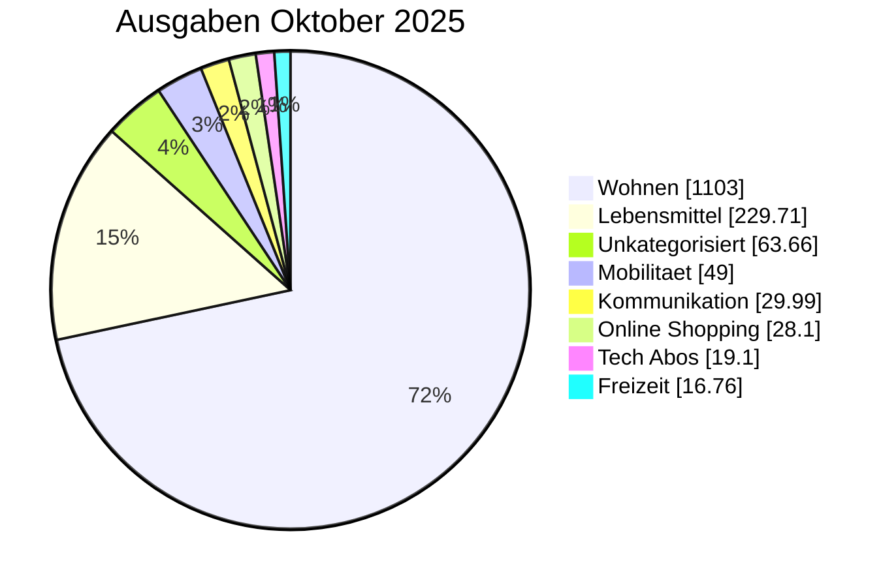

<!-- BEGIN: AUTO-GENERATED -->
> [!info] Oktober 2025 Monatsbericht
> Generiert aus journal.ledger-Daten (2026-10-16). Drei Sichten parallel: Gesamt (inkl. Vermietung), Privat-only (Konto 1+2+Visa), Vermietung-only (Konto 3).

## 📊 Top-Kategorien (Pie)

## 📊 Gesamt-Sicht

### Kennzahlen

| Kennzahl | Wert |
|---|---:|
| Einnahmen | 4.080,00 € |
| Ausgaben | 1.570,41 € |
| Saldo | 2.509,59 € |
| Sparquote | 61.5 % |

### Ausgaben pro Top-Kategorie

| Kategorie | Betrag | Anteil % |
|---|---:|---:|
| [[Finanzplan/45-Kategorien/wohnen\|Wohnen]] | 1.103,00 € | 70.2% |
| [[Finanzplan/45-Kategorien/lebensmittel\|Lebensmittel]] | 229,71 € | 14.6% |
| [[Finanzplan/45-Kategorien/unkategorisiert\|Unkategorisiert]] | 63,66 € | 4.1% |
| [[Finanzplan/45-Kategorien/mobilitaet\|Mobilitaet]] | 49,00 € | 3.1% |
| [[Finanzplan/45-Kategorien/kommunikation\|Kommunikation]] | 29,99 € | 1.9% |
| [[Finanzplan/45-Kategorien/online_shopping\|Online Shopping]] | 28,10 € | 1.8% |
| [[Finanzplan/45-Kategorien/tech_abos\|Tech Abos]] | 19,10 € | 1.2% |
| [[Finanzplan/45-Kategorien/freizeit\|Freizeit]] | 16,76 € | 1.1% |
| [[Finanzplan/45-Kategorien/versicherung\|Versicherung]] | 12,25 € | 0.8% |
| [[Finanzplan/45-Kategorien/gesundheit\|Gesundheit]] | 8,33 € | 0.5% |
| [[Finanzplan/45-Kategorien/essen_auswaerts\|Essen Auswaerts]] | 5,57 € | 0.4% |
| [[Finanzplan/45-Kategorien/bankgebuehren\|Bankgebuehren]] | 4,90 € | 0.3% |
| [[Finanzplan/45-Kategorien/sonstiges\|Sonstiges]] | 0,04 € | 0.0% |
| **Summe** | **1.570,41 €** | 100% |

## 🏠 Privat-only ([[Finanzplan/10-Konten/Konto 01 – Everyday Checking|Konto 01]] + [[Finanzplan/10-Konten/Konto 02 – Household Pool|Konto 02]] + [[Finanzplan/10-Konten/Konto 03 – Everyday Visa|Konto 03]])

> Konto 1 (Hauptkonto) + Konto 2 (Familienpool) + Visa — ohne Konto 3 Vermietung.

### Kennzahlen

| Kennzahl | Wert |
|---|---:|
| Einnahmen | 3.300,00 € |
| Ausgaben | 1.502,37 € |
| Saldo | 1.797,63 € |
| Sparquote | 54.5 % |

### Ausgaben pro Top-Kategorie

| Kategorie | Betrag | Anteil % |
|---|---:|---:|
| [[Finanzplan/45-Kategorien/wohnen\|Wohnen]] | 1.035,00 € | 68.9% |
| [[Finanzplan/45-Kategorien/lebensmittel\|Lebensmittel]] | 229,71 € | 15.3% |
| [[Finanzplan/45-Kategorien/unkategorisiert\|Unkategorisiert]] | 63,66 € | 4.2% |
| [[Finanzplan/45-Kategorien/mobilitaet\|Mobilitaet]] | 49,00 € | 3.3% |
| [[Finanzplan/45-Kategorien/kommunikation\|Kommunikation]] | 29,99 € | 2.0% |
| [[Finanzplan/45-Kategorien/online_shopping\|Online Shopping]] | 28,10 € | 1.9% |
| [[Finanzplan/45-Kategorien/tech_abos\|Tech Abos]] | 19,10 € | 1.3% |
| [[Finanzplan/45-Kategorien/freizeit\|Freizeit]] | 16,76 € | 1.1% |
| [[Finanzplan/45-Kategorien/versicherung\|Versicherung]] | 12,25 € | 0.8% |
| [[Finanzplan/45-Kategorien/gesundheit\|Gesundheit]] | 8,33 € | 0.6% |
| [[Finanzplan/45-Kategorien/essen_auswaerts\|Essen Auswaerts]] | 5,57 € | 0.4% |
| [[Finanzplan/45-Kategorien/bankgebuehren\|Bankgebuehren]] | 4,90 € | 0.3% |
| **Summe** | **1.502,37 €** | 100% |

## 🏘️ Vermietung-only ([[Finanzplan/10-Konten/Konto 04 – Rental|Konto 04]])

> Nur Konto 3 (Vermietung) — Mieteinnahmen und Bewirtschaftungs-Ausgaben.

### Kennzahlen

| Kennzahl | Wert |
|---|---:|
| Einnahmen | 780,00 € |
| Ausgaben | 68,04 € |
| Saldo | 711,96 € |
| Sparquote | 91.3 % |

### Ausgaben pro Top-Kategorie

| Kategorie | Betrag | Anteil % |
|---|---:|---:|
| [[Finanzplan/45-Kategorien/wohnen\|Wohnen]] | 68,00 € | 99.9% |
| [[Finanzplan/45-Kategorien/sonstiges\|Sonstiges]] | 0,04 € | 0.1% |
| **Summe** | **68,04 €** | 100% |

## 💰 Budget-Übersicht

| Kategorie | Soll (Ø 12M) | Ist | Prognose | Diff | Ampel |
|---|---:|---:|---:|---:|:---:|
| [[Finanzplan/45-Kategorien/wohnen\|Wohnen]] | 1.125,00 € | 1.103,00 € | 1.103,00 € | -22,00 € | 🟡 |
| [[Finanzplan/45-Kategorien/lebensmittel\|Lebensmittel]] | 206,59 € | 229,71 € | 229,71 € | 23,12 € | 🔴 |
| [[Finanzplan/45-Kategorien/unkategorisiert\|Unkategorisiert]] | 46,24 € | 63,66 € | 63,66 € | 17,42 € | 🔴 |
| [[Finanzplan/45-Kategorien/mobilitaet\|Mobilitaet]] | 49,00 € | 49,00 € | 49,00 € | 0,00 € | 🟡 |
| [[Finanzplan/45-Kategorien/kommunikation\|Kommunikation]] | 29,99 € | 29,99 € | 29,99 € | 0,00 € | 🟡 |
| [[Finanzplan/45-Kategorien/online_shopping\|Online Shopping]] | 47,88 € | 28,10 € | 28,10 € | -19,78 € | 🟢 |
| [[Finanzplan/45-Kategorien/tech_abos\|Tech Abos]] | 22,65 € | 19,10 € | 19,10 € | -3,55 € | 🟢 |
| [[Finanzplan/45-Kategorien/freizeit\|Freizeit]] | 15,72 € | 16,76 € | 16,76 € | 1,04 € | 🟡 |
| [[Finanzplan/45-Kategorien/versicherung\|Versicherung]] | 33,88 € | 12,25 € | 12,25 € | -21,63 € | 🟢 |
| [[Finanzplan/45-Kategorien/gesundheit\|Gesundheit]] | 21,75 € | 8,33 € | 8,33 € | -13,42 € | 🟢 |
| [[Finanzplan/45-Kategorien/essen_auswaerts\|Essen Auswaerts]] | 16,45 € | 5,57 € | 5,57 € | -10,88 € | 🟢 |
| [[Finanzplan/45-Kategorien/bankgebuehren\|Bankgebuehren]] | 4,90 € | 4,90 € | 4,90 € | 0,00 € | 🟡 |
| [[Finanzplan/45-Kategorien/sonstiges\|Sonstiges]] | 75,62 € | 0,04 € | 0,04 € | -75,58 € | 🟢 |
| [[Finanzplan/45-Kategorien/steuern\|Steuern]] | 1.234,56 € | 0,00 € | 0,00 € | -1.234,56 € | 🟢 |
| [[Finanzplan/45-Kategorien/spende\|Spende]] | 25,00 € | 0,00 € | 0,00 € | -25,00 € | 🟢 |
| [[Finanzplan/45-Kategorien/mitgliedschaft\|Mitgliedschaft]] | 120,00 € | 0,00 € | 0,00 € | -120,00 € | 🟢 |

> [!warning] Avg-Caveat
> Budget-Soll basiert auf nur 1 Monaten Tx-Daten (Bootstrap). Werte sind volatil bis 12 Monate vorliegen. User-Override per `## 📌 Bemerkungen`-Section unten möglich.

## 🏆 Top-Empfänger

| Empfänger | Volumen | Buchungen |
|---|---:|---:|
| [[Finanzplan/60-Empfänger/ausgaben-wohnen-miete\|Hausverwaltung Nord]] | 950,00 € | 1 |
| [[Finanzplan/60-Empfänger/ausgaben-lebensmittel-northwind\|Northwind Grocers]] | 229,71 € | 4 |
| [[Finanzplan/60-Empfänger/ausgaben-wohnen-strom\|Acme Power]] | 85,00 € | 1 |
| [[Finanzplan/60-Empfänger/ausgaben-wohnen-bewirtschaftung\|Miller Stadtwerke]] | 68,00 € | 1 |
| [[Finanzplan/60-Empfänger/ausgaben-unkategorisiert-2026-10-31-me00000001-camt52v8\|Zufallsfirma 9]] | 63,66 € | 1 |

> [!quote]- 📚 Vollständige Empfänger-Liste (Base-Embed)
> ![[Finanzplan/05-Bases/finanzen-empfaenger#📊 Empfänger-Übersicht]]

## 🔗 Verweise

- [[Finanzplan/40-Monatsberichte/40-Monatsberichte|Monatsberichte-Index]]
- [[Finanzplan/_Foundation – Konten-Plan und Kategorien|Foundation]]
- [[Finanzplan/_Dashboard – Finanzen|Dashboard]]
- [[Finanzplan/Ledger/import_report|Import-Report]]
- [[Finanzplan/Finanzplan|Projekt]]
<!-- END: AUTO-GENERATED -->

## 📌 Bemerkungen

_Eigene Notizen / Reflexionen — wird bei Re-Run NICHT überschrieben._
