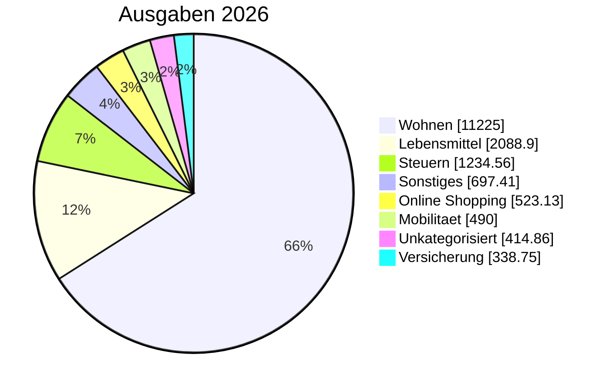

<!-- BEGIN: AUTO-GENERATED -->
> [!info] 2026 Jahresbericht
> Generiert aus journal.ledger-Daten (2026-10-16). Gesamtjahr 2026 (alle Monate mit Postings). Drei Sichten parallel: Gesamt (inkl. Vermietung), Privat-only (Konto 1+2+Visa), Vermietung-only (Konto 3).

## 📊 Top-Kategorien (Pie)

## 📊 Gesamt-Sicht

### Kennzahlen

| Kennzahl | Wert |
|---|---:|
| Einnahmen | 41.000,00 € |
| Ausgaben | 18.404,09 € |
| Saldo | 22.595,91 € |
| Sparquote | 55.1 % |

### Ausgaben pro Top-Kategorie

| Kategorie | Betrag | Anteil % |
|---|---:|---:|
| [[Finanzplan/45-Kategorien/wohnen\|Wohnen]] | 11.225,00 € | 61.0% |
| [[Finanzplan/45-Kategorien/lebensmittel\|Lebensmittel]] | 2.088,90 € | 11.4% |
| [[Finanzplan/45-Kategorien/steuern\|Steuern]] | 1.234,56 € | 6.7% |
| [[Finanzplan/45-Kategorien/sonstiges\|Sonstiges]] | 697,41 € | 3.8% |
| [[Finanzplan/45-Kategorien/online_shopping\|Online Shopping]] | 523,13 € | 2.8% |
| [[Finanzplan/45-Kategorien/mobilitaet\|Mobilitaet]] | 490,00 € | 2.7% |
| [[Finanzplan/45-Kategorien/unkategorisiert\|Unkategorisiert]] | 414,86 € | 2.3% |
| [[Finanzplan/45-Kategorien/versicherung\|Versicherung]] | 338,75 € | 1.8% |
| [[Finanzplan/45-Kategorien/kommunikation\|Kommunikation]] | 299,90 € | 1.6% |
| [[Finanzplan/45-Kategorien/mitgliedschaft\|Mitgliedschaft]] | 240,00 € | 1.3% |
| [[Finanzplan/45-Kategorien/tech_abos\|Tech Abos]] | 234,29 € | 1.3% |
| [[Finanzplan/45-Kategorien/gesundheit\|Gesundheit]] | 202,23 € | 1.1% |
| [[Finanzplan/45-Kategorien/essen_auswaerts\|Essen Auswaerts]] | 165,59 € | 0.9% |
| [[Finanzplan/45-Kategorien/freizeit\|Freizeit]] | 150,47 € | 0.8% |
| [[Finanzplan/45-Kategorien/spende\|Spende]] | 50,00 € | 0.3% |
| [[Finanzplan/45-Kategorien/bankgebuehren\|Bankgebuehren]] | 49,00 € | 0.3% |
| **Summe** | **18.404,09 €** | 100% |

## 🏠 Privat-only ([[Finanzplan/10-Konten/Konto 01 – Everyday Checking|Konto 01]] + [[Finanzplan/10-Konten/Konto 02 – Household Pool|Konto 02]] + [[Finanzplan/10-Konten/Konto 03 – Everyday Visa|Konto 03]])

> Konto 1 (Hauptkonto) + Konto 2 (Familienpool) + Visa — ohne Konto 3 Vermietung.

### Kennzahlen

| Kennzahl | Wert |
|---|---:|
| Einnahmen | 33.200,00 € |
| Ausgaben | 16.967,68 € |
| Saldo | 16.232,32 € |
| Sparquote | 48.9 % |

### Ausgaben pro Top-Kategorie

| Kategorie | Betrag | Anteil % |
|---|---:|---:|
| [[Finanzplan/45-Kategorien/wohnen\|Wohnen]] | 10.486,00 € | 61.8% |
| [[Finanzplan/45-Kategorien/lebensmittel\|Lebensmittel]] | 2.088,90 € | 12.3% |
| [[Finanzplan/45-Kategorien/steuern\|Steuern]] | 1.234,56 € | 7.3% |
| [[Finanzplan/45-Kategorien/online_shopping\|Online Shopping]] | 523,13 € | 3.1% |
| [[Finanzplan/45-Kategorien/mobilitaet\|Mobilitaet]] | 490,00 € | 2.9% |
| [[Finanzplan/45-Kategorien/unkategorisiert\|Unkategorisiert]] | 414,86 € | 2.4% |
| [[Finanzplan/45-Kategorien/versicherung\|Versicherung]] | 338,75 € | 2.0% |
| [[Finanzplan/45-Kategorien/kommunikation\|Kommunikation]] | 299,90 € | 1.8% |
| [[Finanzplan/45-Kategorien/mitgliedschaft\|Mitgliedschaft]] | 240,00 € | 1.4% |
| [[Finanzplan/45-Kategorien/tech_abos\|Tech Abos]] | 234,29 € | 1.4% |
| [[Finanzplan/45-Kategorien/gesundheit\|Gesundheit]] | 202,23 € | 1.2% |
| [[Finanzplan/45-Kategorien/essen_auswaerts\|Essen Auswaerts]] | 165,59 € | 1.0% |
| [[Finanzplan/45-Kategorien/freizeit\|Freizeit]] | 150,47 € | 0.9% |
| [[Finanzplan/45-Kategorien/spende\|Spende]] | 50,00 € | 0.3% |
| [[Finanzplan/45-Kategorien/bankgebuehren\|Bankgebuehren]] | 49,00 € | 0.3% |
| **Summe** | **16.967,68 €** | 100% |

## 🏘️ Vermietung-only ([[Finanzplan/10-Konten/Konto 04 – Rental|Konto 04]])

> Nur Konto 3 (Vermietung) — Mieteinnahmen und Bewirtschaftungs-Ausgaben.

### Kennzahlen

| Kennzahl | Wert |
|---|---:|
| Einnahmen | 7.800,00 € |
| Ausgaben | 1.436,41 € |
| Saldo | 6.363,59 € |
| Sparquote | 81.6 % |

### Ausgaben pro Top-Kategorie

| Kategorie | Betrag | Anteil % |
|---|---:|---:|
| [[Finanzplan/45-Kategorien/wohnen\|Wohnen]] | 739,00 € | 51.4% |
| [[Finanzplan/45-Kategorien/sonstiges\|Sonstiges]] | 697,41 € | 48.6% |
| **Summe** | **1.436,41 €** | 100% |

## 📅 Quartale im Jahr

| Quartal | Einnahmen | Ausgaben | Saldo |
|---|---:|---:|---:|
| [[Finanzplan/70-Quartalsberichte/2026-Q1 Quartalsbericht\|2026-Q1]] | 12.240,00 € | 5.355,35 € | 6.884,65 € |
| [[Finanzplan/70-Quartalsberichte/2026-Q2 Quartalsbericht\|2026-Q2]] | 12.190,00 € | 6.298,88 € | 5.891,12 € |
| [[Finanzplan/70-Quartalsberichte/2026-Q3 Quartalsbericht\|2026-Q3]] | 12.440,00 € | 5.149,07 € | 7.290,93 € |
| [[Finanzplan/70-Quartalsberichte/2026-Q4 Quartalsbericht\|2026-Q4]] | 4.130,00 € | 1.600,79 € | 2.529,21 € |

> [!quote]- 📚 Jahres-Trend (Base-Embed)
> ![[Finanzplan/05-Bases/finanzen-jahresberichte#📅 Jahres-Trend]]

## 🔗 Verweise

- [[Finanzplan/80-Jahresberichte/80-Jahresberichte|Jahresberichte-Index]]
- [[Finanzplan/70-Quartalsberichte/70-Quartalsberichte|Quartalsberichte-Index]]
- [[Finanzplan/40-Monatsberichte/40-Monatsberichte|Monatsberichte-Index]]
- [[Finanzplan/_Foundation – Konten-Plan und Kategorien|Foundation]]
- [[Finanzplan/_Dashboard – Finanzen|Dashboard]]
- [[Finanzplan/Ledger/import_report|Import-Report]]
- [[Finanzplan/Finanzplan|Projekt]]
<!-- END: AUTO-GENERATED -->

## 📌 Bemerkungen

_Eigene Notizen / Reflexionen — wird bei Re-Run NICHT überschrieben._
