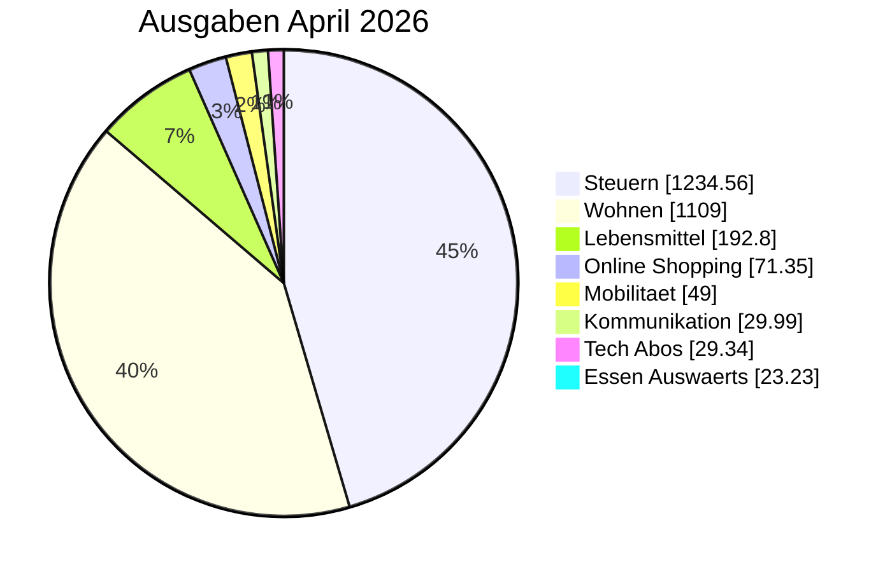

<!-- BEGIN: AUTO-GENERATED -->
> [!info] April 2026 Monatsbericht
> Generiert aus journal.ledger-Daten (2026-10-16). Drei Sichten parallel: Gesamt (inkl. Vermietung), Privat-only (Konto 1+2+Visa), Vermietung-only (Konto 3).

## 📊 Top-Kategorien (Pie)

## 📊 Gesamt-Sicht

### Kennzahlen

| Kennzahl | Wert |
|---|---:|
| Einnahmen | 4.130,00 € |
| Ausgaben | 2.787,93 € |
| Saldo | 1.342,07 € |
| Sparquote | 32.5 % |

### Ausgaben pro Top-Kategorie

| Kategorie | Betrag | Anteil % |
|---|---:|---:|
| [[Finanzplan/45-Kategorien/steuern\|Steuern]] | 1.234,56 € | 44.3% |
| [[Finanzplan/45-Kategorien/wohnen\|Wohnen]] | 1.109,00 € | 39.8% |
| [[Finanzplan/45-Kategorien/lebensmittel\|Lebensmittel]] | 192,80 € | 6.9% |
| [[Finanzplan/45-Kategorien/online_shopping\|Online Shopping]] | 71,35 € | 2.6% |
| [[Finanzplan/45-Kategorien/mobilitaet\|Mobilitaet]] | 49,00 € | 1.8% |
| [[Finanzplan/45-Kategorien/kommunikation\|Kommunikation]] | 29,99 € | 1.1% |
| [[Finanzplan/45-Kategorien/tech_abos\|Tech Abos]] | 29,34 € | 1.1% |
| [[Finanzplan/45-Kategorien/essen_auswaerts\|Essen Auswaerts]] | 23,23 € | 0.8% |
| [[Finanzplan/45-Kategorien/freizeit\|Freizeit]] | 12,32 € | 0.4% |
| [[Finanzplan/45-Kategorien/versicherung\|Versicherung]] | 12,25 € | 0.4% |
| [[Finanzplan/45-Kategorien/gesundheit\|Gesundheit]] | 12,10 € | 0.4% |
| [[Finanzplan/45-Kategorien/unkategorisiert\|Unkategorisiert]] | 7,08 € | 0.3% |
| [[Finanzplan/45-Kategorien/bankgebuehren\|Bankgebuehren]] | 4,90 € | 0.2% |
| [[Finanzplan/45-Kategorien/sonstiges\|Sonstiges]] | 0,01 € | 0.0% |
| **Summe** | **2.787,93 €** | 100% |

## 🏠 Privat-only ([[Finanzplan/10-Konten/Konto 01 – Everyday Checking|Konto 01]] + [[Finanzplan/10-Konten/Konto 02 – Household Pool|Konto 02]] + [[Finanzplan/10-Konten/Konto 03 – Everyday Visa|Konto 03]])

> Konto 1 (Hauptkonto) + Konto 2 (Familienpool) + Visa — ohne Konto 3 Vermietung.

### Kennzahlen

| Kennzahl | Wert |
|---|---:|
| Einnahmen | 3.350,00 € |
| Ausgaben | 2.710,92 € |
| Saldo | 639,08 € |
| Sparquote | 19.1 % |

### Ausgaben pro Top-Kategorie

| Kategorie | Betrag | Anteil % |
|---|---:|---:|
| [[Finanzplan/45-Kategorien/steuern\|Steuern]] | 1.234,56 € | 45.5% |
| [[Finanzplan/45-Kategorien/wohnen\|Wohnen]] | 1.032,00 € | 38.1% |
| [[Finanzplan/45-Kategorien/lebensmittel\|Lebensmittel]] | 192,80 € | 7.1% |
| [[Finanzplan/45-Kategorien/online_shopping\|Online Shopping]] | 71,35 € | 2.6% |
| [[Finanzplan/45-Kategorien/mobilitaet\|Mobilitaet]] | 49,00 € | 1.8% |
| [[Finanzplan/45-Kategorien/kommunikation\|Kommunikation]] | 29,99 € | 1.1% |
| [[Finanzplan/45-Kategorien/tech_abos\|Tech Abos]] | 29,34 € | 1.1% |
| [[Finanzplan/45-Kategorien/essen_auswaerts\|Essen Auswaerts]] | 23,23 € | 0.9% |
| [[Finanzplan/45-Kategorien/freizeit\|Freizeit]] | 12,32 € | 0.5% |
| [[Finanzplan/45-Kategorien/versicherung\|Versicherung]] | 12,25 € | 0.5% |
| [[Finanzplan/45-Kategorien/gesundheit\|Gesundheit]] | 12,10 € | 0.4% |
| [[Finanzplan/45-Kategorien/unkategorisiert\|Unkategorisiert]] | 7,08 € | 0.3% |
| [[Finanzplan/45-Kategorien/bankgebuehren\|Bankgebuehren]] | 4,90 € | 0.2% |
| **Summe** | **2.710,92 €** | 100% |

## 🏘️ Vermietung-only ([[Finanzplan/10-Konten/Konto 04 – Rental|Konto 04]])

> Nur Konto 3 (Vermietung) — Mieteinnahmen und Bewirtschaftungs-Ausgaben.

### Kennzahlen

| Kennzahl | Wert |
|---|---:|
| Einnahmen | 780,00 € |
| Ausgaben | 77,01 € |
| Saldo | 702,99 € |
| Sparquote | 90.1 % |

### Ausgaben pro Top-Kategorie

| Kategorie | Betrag | Anteil % |
|---|---:|---:|
| [[Finanzplan/45-Kategorien/wohnen\|Wohnen]] | 77,00 € | 100.0% |
| [[Finanzplan/45-Kategorien/sonstiges\|Sonstiges]] | 0,01 € | 0.0% |
| **Summe** | **77,01 €** | 100% |

## 💰 Budget-Übersicht

| Kategorie | Soll (Ø 12M) | Ist | Prognose | Diff | Ampel |
|---|---:|---:|---:|---:|:---:|
| [[Finanzplan/45-Kategorien/steuern\|Steuern]] | 1.234,56 € | 1.234,56 € | 1.234,56 € | 0,00 € | 🟡 |
| [[Finanzplan/45-Kategorien/wohnen\|Wohnen]] | 1.125,00 € | 1.109,00 € | 1.109,00 € | -16,00 € | 🟡 |
| [[Finanzplan/45-Kategorien/lebensmittel\|Lebensmittel]] | 206,59 € | 192,80 € | 192,80 € | -13,79 € | 🟡 |
| [[Finanzplan/45-Kategorien/online_shopping\|Online Shopping]] | 47,88 € | 71,35 € | 71,35 € | 23,47 € | 🔴 |
| [[Finanzplan/45-Kategorien/mobilitaet\|Mobilitaet]] | 49,00 € | 49,00 € | 49,00 € | 0,00 € | 🟡 |
| [[Finanzplan/45-Kategorien/kommunikation\|Kommunikation]] | 29,99 € | 29,99 € | 29,99 € | 0,00 € | 🟡 |
| [[Finanzplan/45-Kategorien/tech_abos\|Tech Abos]] | 22,65 € | 29,34 € | 29,34 € | 6,69 € | 🔴 |
| [[Finanzplan/45-Kategorien/essen_auswaerts\|Essen Auswaerts]] | 16,45 € | 23,23 € | 23,23 € | 6,78 € | 🔴 |
| [[Finanzplan/45-Kategorien/freizeit\|Freizeit]] | 15,72 € | 12,32 € | 12,32 € | -3,40 € | 🟢 |
| [[Finanzplan/45-Kategorien/versicherung\|Versicherung]] | 33,88 € | 12,25 € | 12,25 € | -21,63 € | 🟢 |
| [[Finanzplan/45-Kategorien/gesundheit\|Gesundheit]] | 21,75 € | 12,10 € | 12,10 € | -9,65 € | 🟢 |
| [[Finanzplan/45-Kategorien/unkategorisiert\|Unkategorisiert]] | 46,24 € | 7,08 € | 7,08 € | -39,16 € | 🟢 |
| [[Finanzplan/45-Kategorien/bankgebuehren\|Bankgebuehren]] | 4,90 € | 4,90 € | 4,90 € | 0,00 € | 🟡 |
| [[Finanzplan/45-Kategorien/sonstiges\|Sonstiges]] | 75,62 € | 0,01 € | 0,01 € | -75,61 € | 🟢 |
| [[Finanzplan/45-Kategorien/spende\|Spende]] | 25,00 € | 0,00 € | 0,00 € | -25,00 € | 🟢 |
| [[Finanzplan/45-Kategorien/mitgliedschaft\|Mitgliedschaft]] | 120,00 € | 0,00 € | 0,00 € | -120,00 € | 🟢 |

> [!warning] Avg-Caveat
> Budget-Soll basiert auf nur 1 Monaten Tx-Daten (Bootstrap). Werte sind volatil bis 12 Monate vorliegen. User-Override per `## 📌 Bemerkungen`-Section unten möglich.

## 🏆 Top-Empfänger

| Empfänger | Volumen | Buchungen |
|---|---:|---:|
| [[Finanzplan/60-Empfänger/ausgaben-steuern-einkommen\|Finanzamt Mitte]] | 1.234,56 € | 1 |
| [[Finanzplan/60-Empfänger/ausgaben-wohnen-miete\|Hausverwaltung Nord]] | 950,00 € | 1 |
| [[Finanzplan/60-Empfänger/ausgaben-lebensmittel-northwind\|Northwind Grocers]] | 192,80 € | 4 |
| [[Finanzplan/60-Empfänger/ausgaben-wohnen-strom\|Acme Power]] | 82,00 € | 1 |
| [[Finanzplan/60-Empfänger/ausgaben-wohnen-bewirtschaftung\|Miller Stadtwerke]] | 77,00 € | 1 |

> [!quote]- 📚 Vollständige Empfänger-Liste (Base-Embed)
> ![[Finanzplan/05-Bases/finanzen-empfaenger#📊 Empfänger-Übersicht]]

## 🔗 Verweise

- [[Finanzplan/40-Monatsberichte/40-Monatsberichte|Monatsberichte-Index]]
- [[Finanzplan/_Foundation – Konten-Plan und Kategorien|Foundation]]
- [[Finanzplan/_Dashboard – Finanzen|Dashboard]]
- [[Finanzplan/Ledger/import_report|Import-Report]]
- [[Finanzplan/Finanzplan|Projekt]]
<!-- END: AUTO-GENERATED -->

## 📌 Bemerkungen

_Eigene Notizen / Reflexionen — wird bei Re-Run NICHT überschrieben._
