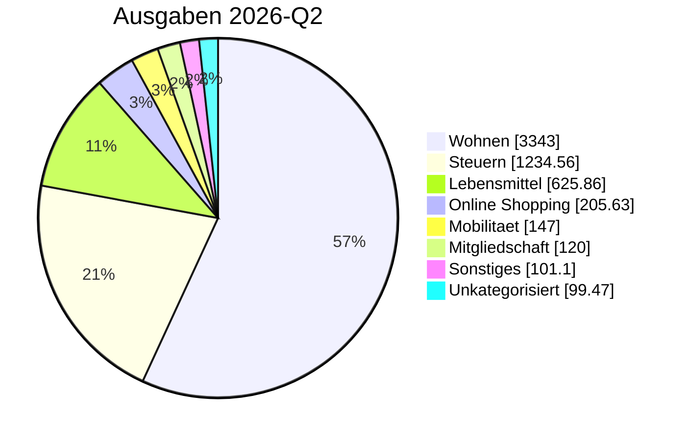

<!-- BEGIN: AUTO-GENERATED -->
> [!info] 2026-Q2 Quartalsbericht
> Generiert aus journal.ledger-Daten (2026-10-16). Monate 04–06/2026. Drei Sichten parallel: Gesamt (inkl. Vermietung), Privat-only (Konto 1+2+Visa), Vermietung-only (Konto 3).

## 📊 Top-Kategorien (Pie)

## 📊 Gesamt-Sicht

### Kennzahlen

| Kennzahl | Wert |
|---|---:|
| Einnahmen | 12.190,00 € |
| Ausgaben | 6.298,88 € |
| Saldo | 5.891,12 € |
| Sparquote | 48.3 % |

### Ausgaben pro Top-Kategorie

| Kategorie | Betrag | Anteil % |
|---|---:|---:|
| [[Finanzplan/45-Kategorien/wohnen\|Wohnen]] | 3.343,00 € | 53.1% |
| [[Finanzplan/45-Kategorien/steuern\|Steuern]] | 1.234,56 € | 19.6% |
| [[Finanzplan/45-Kategorien/lebensmittel\|Lebensmittel]] | 625,86 € | 9.9% |
| [[Finanzplan/45-Kategorien/online_shopping\|Online Shopping]] | 205,63 € | 3.3% |
| [[Finanzplan/45-Kategorien/mobilitaet\|Mobilitaet]] | 147,00 € | 2.3% |
| [[Finanzplan/45-Kategorien/mitgliedschaft\|Mitgliedschaft]] | 120,00 € | 1.9% |
| [[Finanzplan/45-Kategorien/sonstiges\|Sonstiges]] | 101,10 € | 1.6% |
| [[Finanzplan/45-Kategorien/unkategorisiert\|Unkategorisiert]] | 99,47 € | 1.6% |
| [[Finanzplan/45-Kategorien/kommunikation\|Kommunikation]] | 89,97 € | 1.4% |
| [[Finanzplan/45-Kategorien/versicherung\|Versicherung]] | 80,00 € | 1.3% |
| [[Finanzplan/45-Kategorien/tech_abos\|Tech Abos]] | 68,17 € | 1.1% |
| [[Finanzplan/45-Kategorien/essen_auswaerts\|Essen Auswaerts]] | 52,51 € | 0.8% |
| [[Finanzplan/45-Kategorien/gesundheit\|Gesundheit]] | 47,54 € | 0.8% |
| [[Finanzplan/45-Kategorien/freizeit\|Freizeit]] | 44,37 € | 0.7% |
| [[Finanzplan/45-Kategorien/spende\|Spende]] | 25,00 € | 0.4% |
| [[Finanzplan/45-Kategorien/bankgebuehren\|Bankgebuehren]] | 14,70 € | 0.2% |
| **Summe** | **6.298,88 €** | 100% |

## 🏠 Privat-only ([[Finanzplan/10-Konten/Konto 01 – Everyday Checking|Konto 01]] + [[Finanzplan/10-Konten/Konto 02 – Household Pool|Konto 02]] + [[Finanzplan/10-Konten/Konto 03 – Everyday Visa|Konto 03]])

> Konto 1 (Hauptkonto) + Konto 2 (Familienpool) + Visa — ohne Konto 3 Vermietung.

### Kennzahlen

| Kennzahl | Wert |
|---|---:|
| Einnahmen | 9.850,00 € |
| Ausgaben | 5.981,78 € |
| Saldo | 3.868,22 € |
| Sparquote | 39.3 % |

### Ausgaben pro Top-Kategorie

| Kategorie | Betrag | Anteil % |
|---|---:|---:|
| [[Finanzplan/45-Kategorien/wohnen\|Wohnen]] | 3.127,00 € | 52.3% |
| [[Finanzplan/45-Kategorien/steuern\|Steuern]] | 1.234,56 € | 20.6% |
| [[Finanzplan/45-Kategorien/lebensmittel\|Lebensmittel]] | 625,86 € | 10.5% |
| [[Finanzplan/45-Kategorien/online_shopping\|Online Shopping]] | 205,63 € | 3.4% |
| [[Finanzplan/45-Kategorien/mobilitaet\|Mobilitaet]] | 147,00 € | 2.5% |
| [[Finanzplan/45-Kategorien/mitgliedschaft\|Mitgliedschaft]] | 120,00 € | 2.0% |
| [[Finanzplan/45-Kategorien/unkategorisiert\|Unkategorisiert]] | 99,47 € | 1.7% |
| [[Finanzplan/45-Kategorien/kommunikation\|Kommunikation]] | 89,97 € | 1.5% |
| [[Finanzplan/45-Kategorien/versicherung\|Versicherung]] | 80,00 € | 1.3% |
| [[Finanzplan/45-Kategorien/tech_abos\|Tech Abos]] | 68,17 € | 1.1% |
| [[Finanzplan/45-Kategorien/essen_auswaerts\|Essen Auswaerts]] | 52,51 € | 0.9% |
| [[Finanzplan/45-Kategorien/gesundheit\|Gesundheit]] | 47,54 € | 0.8% |
| [[Finanzplan/45-Kategorien/freizeit\|Freizeit]] | 44,37 € | 0.7% |
| [[Finanzplan/45-Kategorien/spende\|Spende]] | 25,00 € | 0.4% |
| [[Finanzplan/45-Kategorien/bankgebuehren\|Bankgebuehren]] | 14,70 € | 0.2% |
| **Summe** | **5.981,78 €** | 100% |

## 🏘️ Vermietung-only ([[Finanzplan/10-Konten/Konto 04 – Rental|Konto 04]])

> Nur Konto 3 (Vermietung) — Mieteinnahmen und Bewirtschaftungs-Ausgaben.

### Kennzahlen

| Kennzahl | Wert |
|---|---:|
| Einnahmen | 2.340,00 € |
| Ausgaben | 317,10 € |
| Saldo | 2.022,90 € |
| Sparquote | 86.4 % |

### Ausgaben pro Top-Kategorie

| Kategorie | Betrag | Anteil % |
|---|---:|---:|
| [[Finanzplan/45-Kategorien/wohnen\|Wohnen]] | 216,00 € | 68.1% |
| [[Finanzplan/45-Kategorien/sonstiges\|Sonstiges]] | 101,10 € | 31.9% |
| **Summe** | **317,10 €** | 100% |

## 📅 Monate im Quartal

| Monat | Einnahmen | Ausgaben | Saldo |
|---|---:|---:|---:|
| [[Finanzplan/40-Monatsberichte/2026-04 Monatsbericht\|2026-04]] | 4.130,00 € | 2.787,93 € | 1.342,07 € |
| [[Finanzplan/40-Monatsberichte/2026-05 Monatsbericht\|2026-05]] | 3.980,00 € | 1.682,92 € | 2.297,08 € |
| [[Finanzplan/40-Monatsberichte/2026-06 Monatsbericht\|2026-06]] | 4.080,00 € | 1.828,03 € | 2.251,97 € |

> [!quote]- 📚 Quartals-Trend (Base-Embed)
> ![[Finanzplan/05-Bases/finanzen-quartalsberichte#📊 Quartals-Trend]]

## 🔗 Verweise

- [[Finanzplan/70-Quartalsberichte/70-Quartalsberichte|Quartalsberichte-Index]]
- [[Finanzplan/40-Monatsberichte/40-Monatsberichte|Monatsberichte-Index]]
- [[Finanzplan/_Foundation – Konten-Plan und Kategorien|Foundation]]
- [[Finanzplan/_Dashboard – Finanzen|Dashboard]]
- [[Finanzplan/Ledger/import_report|Import-Report]]
- [[Finanzplan/Finanzplan|Projekt]]
<!-- END: AUTO-GENERATED -->

## 📌 Bemerkungen

_Eigene Notizen / Reflexionen — wird bei Re-Run NICHT überschrieben._
