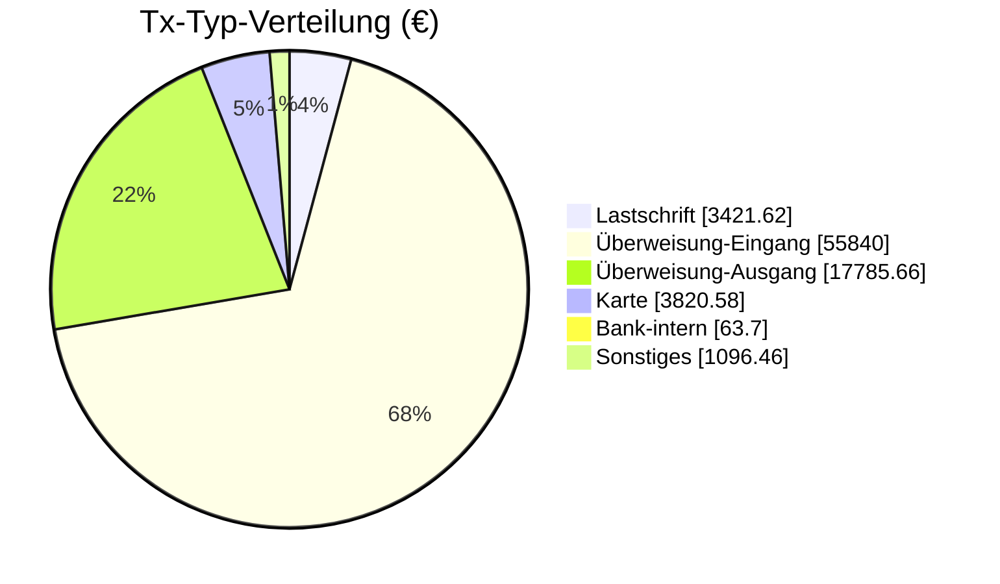

<!-- BEGIN: AUTO-GENERATED -->
> [!info] Karte — alltime Tx-Typ-Aggregat
> Klassifiziert via `buchungstext`-Heuristik (Slice-10 D0.5). Drill-Down auf einzelne Tx erfolgt via Empfänger-Notes (siehe Top-Empfänger unten).

## 📊 Aggregat-Übersicht

| Kennzahl | Wert |
|---|---:|
| Gesamt (alltime) | 3.820,58 € |
| Tx-Count (alltime) | 91 |
| Ø pro Tx | 41,98 € |
| Max Einzeltx | 78,49 € |
| Min Einzeltx | 8,33 € |

## 🏆 Top-10 Empfänger (Karte)

| Empfänger | Volumen | Tx |
|---|---:|---:|
| [[Finanzplan/60-Empfänger/ausgaben-lebensmittel-northwind\|Northwind]] | 2.708,84 € | 52 |
| [[Finanzplan/60-Empfänger/ausgaben-mobilitaet-opnv\|OPNV]] | 637,00 € | 13 |
| [[Finanzplan/60-Empfänger/ausgaben-gesundheit-apotheke\|Apotheke]] | 269,31 € | 13 |
| [[Finanzplan/60-Empfänger/ausgaben-freizeit-kino\|Kino]] | 205,43 € | 13 |

## 📈 Tx-Typ-Verteilung (alltime, alle Klassen)

## 🔗 Verbindungen

- Tx-Typen-Hub: [[Finanzplan/50-Tx-Typen/50-Tx-Typen|50-Tx-Typen]]
- Empfänger-Index: [[Finanzplan/60-Empfänger/60-Empfänger|60-Empfänger]]
- Foundation: [[Finanzplan/_Foundation – Konten-Plan und Kategorien|Foundation]]
<!-- END: AUTO-GENERATED -->

## 📌 Notizen

_Eigene Anmerkungen zu dieser Tx-Typ-Klasse — wird bei Re-Run NICHT überschrieben._
