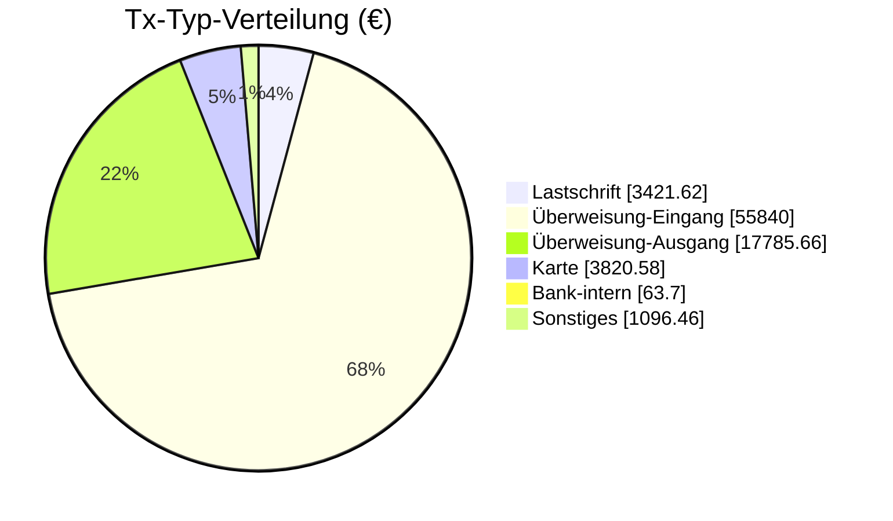

<!-- BEGIN: AUTO-GENERATED -->
> [!info] Überweisung-Eingang — alltime Tx-Typ-Aggregat
> Klassifiziert via `buchungstext`-Heuristik (Slice-10 D0.5). Drill-Down auf einzelne Tx erfolgt via Empfänger-Notes (siehe Top-Empfänger unten).

## 📊 Aggregat-Übersicht

| Kennzahl | Wert |
|---|---:|
| Gesamt (alltime) | 53.240,00 € |
| Tx-Count (alltime) | 26 |
| Ø pro Tx | 2.047,69 € |
| Max Einzeltx | 3.450,00 € |
| Min Einzeltx | 780,00 € |

## 🏆 Top-10 Empfänger (Überweisung-Eingang)

| Empfänger | Volumen | Tx |
|---|---:|---:|
| [[Finanzplan/60-Empfänger/einnahmen-gehalt-globex\|Globex]] | 43.100,00 € | 13 |
| [[Finanzplan/60-Empfänger/einnahmen-miete-mieter\|Mieter]] | 10.140,00 € | 13 |

## 📈 Tx-Typ-Verteilung (alltime, alle Klassen)

## 🔗 Verbindungen

- Tx-Typen-Hub: [[Finanzplan/50-Tx-Typen/50-Tx-Typen|50-Tx-Typen]]
- Empfänger-Index: [[Finanzplan/60-Empfänger/60-Empfänger|60-Empfänger]]
- Foundation: [[Finanzplan/_Foundation – Konten-Plan und Kategorien|Foundation]]
<!-- END: AUTO-GENERATED -->

## 📌 Notizen

_Eigene Anmerkungen zu dieser Tx-Typ-Klasse — wird bei Re-Run NICHT überschrieben._
